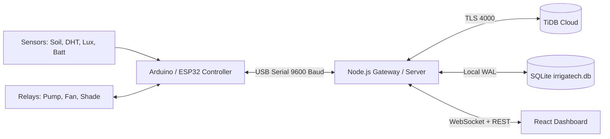

# 🌱 Irriga-Tech: Smart Greenhouse IoT & Autonomous Irrigation Platform

> **AI-Driven • Solar-Powered • IoT Enabled**  
> Complete agricultural automation system featuring an Arduino/ESP32 firmware node, real-time Node.js gateway, TiDB Cloud distributed SQL persistence, offline SQLite fallback, and a modern responsive React web dashboard.

---

## 🚀 Key Features

- **Real-Time Greenhouse Telemetry**: Continuous monitoring of soil moisture (FC-28), ambient temperature & humidity (DHT11/DHT22), sunlight lux levels, battery state-of-charge, and water reservoir levels.
- **Autonomous & Manual Actuation**: Dual-mode controls for 12V/240V irrigation pump relays, climate ventilation fans, and motorized shade cloth with hardware safety timeouts.
- **Dual-Layer Database Architecture**:
  - **Cloud Layer**: TiDB Cloud Serverless Distributed SQL cluster for centralized multi-farm telemetry and analytics.
  - **Edge Layer**: Local SQLite (`better-sqlite3` with WAL mode) for zero-downtime offline operation on Raspberry Pi / Greenhouse PC.
- **AI Crop Nutrition Advisory**: Vapor Pressure Deficit (VPD) estimation, stomatal stress detection, and agronomist human-in-the-loop review pipeline.
- **Responsive Dashboard**: Mobile-first bottom navigation and desktop dashboard layouts matching the Irriga-Tech design system.

---

## 🛠️ System Architecture



---

## 🔌 Hardware Wiring & Pinout

| Peripheral | Arduino / ESP32 Pin | Type | Notes |
| :--- | :---: | :---: | :--- |
| **DHT11 / DHT22** | `D2` | Digital In | Temperature & Humidity |
| **FC-28 Soil Hygrometer** | `A0` | Analog In | Soil moisture percentage |
| **LDR Photoresistor** | `A1` | Analog In | Ambient light intensity |
| **Battery Voltage Divider** | `A2` | Analog In | 12V solar battery monitor |
| **Water Level Sensor** | `A3` | Analog In | Water tank reservoir depth |
| **Irrigation Pump Relay** | `D3` | Digital Out | Relay Channel 1 (Active LOW/HIGH) |
| **Ventilation Fan Relay** | `D7` | Digital Out | Relay Channel 2 |
| **Motorized Shade Mesh** | `D9` | PWM Out | 0–100% shade cloth deployment |
| **LCD 16×2 Display** | `SDA / SCL` | I2C (`0x27`) | Field diagnostics display |

Firmware source is located in [`firmware/irriga_tech_firmware.ino`](firmware/irriga_tech_firmware.ino).

---

## 📦 Getting Started

### 1. Prerequisites
- Node.js 18+ & npm
- Arduino IDE (if uploading firmware to microcontroller)

### 2. Backend Server Setup
```bash
cd server
npm install
cp .env.example .env
# Edit .env with your TiDB Cloud credentials
npm start
```

### 3. Frontend Dashboard Setup
```bash
# In the project root
npm install
npm run dev
```
Open [http://localhost:5173](http://localhost:5173) in your browser.

---

## ☁️ Cloud Deployment

### Backend (Railway)
1. Go to [railway.app](https://railway.app) and click **New Project** → **Deploy from GitHub repo**.
2. Select `jakommatin-design/irrigatech`.
3. In **Variables**, add your TiDB Cloud credentials:
   - `TIDB_HOST` = `gateway01.ap-northeast-1.prod.aws.tidbcloud.com`
   - `TIDB_PORT` = `4000`
   - `TIDB_USER` = `V5nFR5aVnYe1aC9.root`
   - `TIDB_PASSWORD` = `5CSKLufPf7lwzngF`
   - `TIDB_DATABASE` = `irrigatech`
   - `TIDB_SSL` = `true`
   - `PORT` = `3000`
4. In **Settings** → **Networking**, click **Generate Domain** (e.g. `irrigatech-production.up.railway.app`).

### Frontend (Vercel)
1. Go to [vercel.com](https://vercel.com) and click **Add New** → **Project**.
2. Import `jakommatin-design/irrigatech`.
3. In **Environment Variables**, add:
   - `VITE_SERVER_URL` = `https://your-railway-app.up.railway.app`
4. Click **Deploy**.

---

## 📄 License
MIT License. Developed for smart greenhouse automation and precision agriculture.

