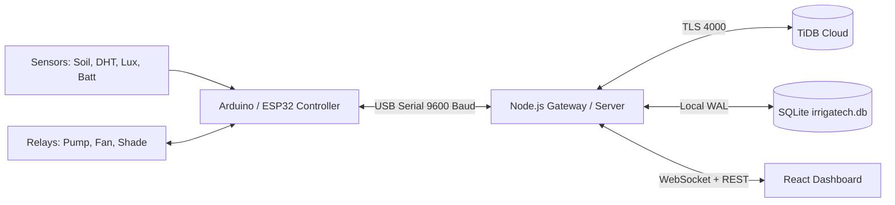

# 🌱 Irriga-Tech: Smart Greenhouse IoT & Autonomous Irrigation Platform

> **AI-Driven • Solar-Powered • IoT Enabled**  
> Complete agricultural automation system featuring an Arduino/ESP32 firmware node, real-time Node.js gateway, TiDB Cloud distributed SQL persistence, offline SQLite fallback, and a modern responsive React web dashboard.

---

## 🚀 Key Features

- **Real-Time Greenhouse Telemetry**: Continuous monitoring of soil moisture (FC-28), ambient temperature & humidity (DHT11/DHT22), sunlight lux levels, battery state-of-charge, and water reservoir levels.
- **Autonomous & Manual Actuation**: Dual-mode controls for 12V/240V irrigation pump relays, climate ventilation fans, and motorized shade cloth with hardware safety timeouts.
- **Dual-Layer Database Architecture**:
  - **Cloud Layer**: TiDB Cloud Serverless Distributed SQL cluster for centralized multi-farm telemetry and analytics.
  - **Edge Layer**: Local SQLite (`better-sqlite3` with WAL mode) for zero-downtime offline operation on Raspberry Pi / Greenhouse PC.
- **AI Crop Nutrition Advisory**: Vapor Pressure Deficit (VPD) estimation, stomatal stress detection, and agronomist human-in-the-loop review pipeline.
- **Responsive Dashboard**: Mobile-first bottom navigation and desktop dashboard layouts matching the Irriga-Tech design system.

---

## 🛠️ System Architecture



---

## 🔌 Hardware Wiring & Pinout

| Peripheral | Arduino / ESP32 Pin | Type | Notes |
| :--- | :---: | :---: | :--- |
| **DHT11 / DHT22** | `D2` | Digital In | Temperature & Humidity |
| **FC-28 Soil Hygrometer** | `A0` | Analog In | Soil moisture percentage |
| **LDR Photoresistor** | `A1` | Analog In | Ambient light intensity |
| **Battery Voltage Divider** | `A2` | Analog In | 12V solar battery monitor |
| **Water Level Sensor** | `A3` | Analog In | Water tank reservoir depth |
| **Irrigation Pump Relay** | `D3` | Digital Out | Relay Channel 1 (Active LOW/HIGH) |
| **Ventilation Fan Relay** | `D7` | Digital Out | Relay Channel 2 |
| **Motorized Shade Mesh** | `D9` | PWM Out | 0–100% shade cloth deployment |
| **LCD 16×2 Display** | `SDA / SCL` | I2C (`0x27`) | Field diagnostics display |

Firmware source is located in [`firmware/irriga_tech_firmware.ino`](firmware/irriga_tech_firmware.ino).

---

## 📦 Getting Started

### 1. Prerequisites
- Node.js 18+ & npm
- Arduino IDE (if uploading firmware to microcontroller)

### 2. Local Development (Frontend + Backend)
Install dependencies in both folders once. Configure `server/.env.local` (or `server/.env`) for your backend credentials, connect and flash the ESP32, then start the frontend and backend together:
```powershell
npm install
npm --prefix server install
npm run dev:all
```
Open [http://localhost:5173](http://localhost:5173). The backend listens on `http://localhost:3000`. To force a specific USB port, set `SERIAL_PORT=COM3` (replace `COM3` with the port shown in Windows Device Manager) and `SERIAL_BAUD_RATE=9600` in `server/.env.local`. The firmware must use the same baud rate. Leave `SERIAL_PORT` blank to auto-detect supported Arduino/ESP32 USB adapters. `npm --prefix server run list-serial-ports` lists ports the backend can see. Close Arduino Serial Monitor before starting the backend because only one program can use a serial port at a time.

---

## ☁️ Cloud Deployment

### Backend (Railway)
1. Go to [railway.app](https://railway.app) and click **New Project** → **Deploy from GitHub repo**.
2. Select `jakommatin-design/irrigatech`.
3. In **Variables**, add your TiDB Cloud credentials:
   - `TIDB_HOST` = `<your-cluster-host>.prod.aws.tidbcloud.com`
   - `TIDB_PORT` = `4000`
   - `TIDB_USER` = `<your-tidb-username>`
   - `TIDB_PASSWORD` = `<your-secure-tidb-password>`
   - `TIDB_DATABASE` = `irrigatech`
   - `TIDB_SSL` = `true`
   - `JWT_SECRET` = a unique, randomly generated secret (required; use the same value across backend instances)
   - `PORT` = `3000`
4. In **Settings** → **Networking**, click **Generate Domain** (e.g. `irrigatech-production.up.railway.app`).
   Railway provisions HTTPS for its generated domain automatically. Open the generated `https://` URL to use the combined frontend and API deployment. Do not use the raw service address or an `http://` URL for browser notifications.
5. Add these server-only variables in Railway **Variables** for signed Cloudinary profile-photo uploads:
   - `CLOUDINARY_CLOUD_NAME`
   - `CLOUDINARY_API_KEY`
   - `CLOUDINARY_API_SECRET`
   Keep `CLOUDINARY_API_SECRET` out of frontend variables. Local values go in `server/.env.local`.
6. Add these server-only variables in Railway **Variables** to enable real Africa's Talking SMS:
   - `AT_USERNAME` = your Africa's Talking app username (`Irriga-Tech` for the credentials provided for local setup)
   - `AT_API_KEY` = the API key from the Africa's Talking dashboard (keep it in Railway Variables; never use a `VITE_` variable)
   - `AT_SENDER_ID` = only the sender ID approved for your Africa's Talking account; omit this until it is approved

For local development, place these `AT_*` variables in `server/.env.local`. That file is ignored by Git and is loaded by the backend. Never copy API keys into the frontend `.env.local` or commit a credentials file. Local `localhost` is treated as a secure context by browsers; production OS notifications require the HTTPS Railway/Vercel domain and the user to allow the browser prompt.

### Frontend (Vercel)
1. Go to [vercel.com](https://vercel.com) and click **Add New** → **Project**.
2. Import `jakommatin-design/irrigatech`.
3. In **Environment Variables**, add:
   - `VITE_SERVER_URL` = the generated Railway backend URL beginning with `https://`
4. Click **Deploy**.

Browser/OS notifications require the deployed site to use HTTPS and the user to allow notifications in the browser prompt. The app can show alerts while it is open or running in the background; alerts after the site is fully closed require a Web Push service and VAPID keys, which are not configured yet.

---

## 📄 License
MIT License. Developed for smart greenhouse automation and precision agriculture.

