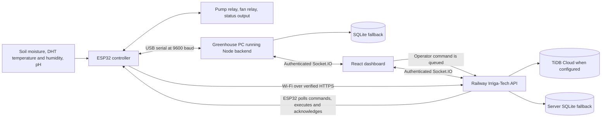

# Irriga-Tech Hybrid USB and Hosted Hardware Guide

## Purpose and current state

This guide explains how one ESP32 greenhouse controller can work with Irriga-Tech locally over USB and remotely through the hosted site over Wi-Fi and HTTPS. The server accepts cloud telemetry only when a server-side device token and greenhouse owner ID are configured. The firmware sends USB serial readings continuously and, when compiled with `firmware/secrets.h`, also posts readings to the hosted endpoint. Hosted operator commands are queued by the server and retrieved by the device. USB remains useful when the greenhouse PC is available or the Internet is down.

The source now contains the USB bridge, the authenticated HTTP telemetry endpoint, a cloud command queue with acknowledgements, and optional ESP32 HTTPS client code. To make cloud hardware live, an operator still must supply the site Wi-Fi credentials, a random device token, the correct account owner ID, the Railway URL, and the API host's trusted root CA certificate. No hardware was attached during implementation, so wiring, actual sensor calibration, firmware compilation for the user's specific board, Railway variables and live device communication still need field setup.

## Hybrid architecture



### Data flow

1. The ESP32 samples its sensors every two seconds and emits one JSON line to USB serial. The local backend parses the line, stores the reading and broadcasts it to signed-in dashboard sessions.
2. Every ten seconds, an ESP32 configured for hosted mode sends a JSON POST to `/api/device/telemetry` using HTTPS and the `X-Device-Token` header. The server checks the token, device ID, numeric ranges and required values, then persists the reading and emits live status and telemetry only to the configured greenhouse owner's Socket.IO room.
3. The hosted dashboard sends operator commands through its authenticated Socket.IO session. If recent cloud telemetry proves that the device is online, the server puts the command in a short in-memory queue. The ESP32 polls `/api/device/commands` every five seconds, executes the command, and acknowledges it at `/api/device/commands/:id/ack`.
4. The hosted API marks the cloud device offline after 45 seconds without telemetry and clears pending commands. The device keeps local sensor and safety logic running even if the network is unavailable.

## Device wiring used by the ESP32 firmware

### Starter device list

| Device | Why it is needed | Check before buying/connecting |
| --- | --- | --- |
| ESP32 DevKit board with ESP32-WROOM-32E or compatible module | Reads sensors, sends USB and Wi-Fi data, polls hosted commands. | Use a genuine USB data cable and a board with ADC1 pins GPIO34/35. |
| DHT11 temperature/humidity sensor | Already supported by the current firmware. | DHT22 is usually a better sensor but requires changing `DHTTYPE` and recompiling. |
| Capacitive soil moisture sensor with analog output | Measures soil water content with better corrosion resistance than a resistive probe. | Output voltage must not exceed 3.3 V; calibrate using the actual growing medium. |
| pH probe plus conditioned interface board | Provides a voltage that the ESP32 ADC can measure. | Confirm the output range is 0–3.3 V; calibrate with pH buffer solutions. A bare probe cannot connect directly. |
| 3.3 V logic-compatible isolated relay/driver board | Switches pump and fan power from ESP32 GPIO signals. | Verify input polarity, current rating, isolation, load voltage, enclosure and suitable fuse. Never drive the motor directly from a GPIO. |
| Regulated supply, USB data cable, jumper wires and protected enclosure | Powers and protects the prototype. | Size the supply for the ESP32, sensors and relay board; keep wet-area and mains wiring physically separated. |
| 2.4 GHz Wi-Fi router or access point | Connects the board to the hosted HTTPS backend. | Confirm the greenhouse has a stable Internet route and that client isolation/firewall rules allow HTTPS outbound access. |

The ESP32 pin map is selected automatically when compiling for an ESP32 board. Classic Arduino builds keep their earlier D2/A0/A1/D3/D7/D8 mapping for USB use. Use an ESP32 DevKit board with a 3.3 V logic level. Never connect a 5 V sensor output to an ESP32 GPIO or ADC input.

| Device | ESP32 pin in firmware | Wiring notes |
| --- | --- | --- |
| DHT11 data | GPIO 4 | Power the sensor module as its datasheet specifies; add a pull-up if the module does not include one. |
| Soil moisture analog output | GPIO 34 / ADC1 | Use a 3.3 V compatible capacitive sensor for longer service life. Verify its maximum output voltage. |
| pH interface analog output | GPIO 35 / ADC1 | Use a conditioned pH interface whose output stays within the ESP32 ADC range. Calibrate with buffer solutions. |
| Pump relay input | GPIO 25 | Use a properly rated, isolated driver/relay; do not power a pump from the ESP32. |
| Ventilation relay input | GPIO 26 | Size for the fan load; isolate mains voltage and use an enclosure. |
| Status LED/buzzer input | GPIO 27 | Use a suitable resistor or driver module. |
| LCD I2C | Board SDA/SCL | The sketch expects an I2C LCD at address `0x27`; scan the bus if it stays blank. |

The sketch's moisture value is a normalized ADC percentage. Calibrate the wet and dry endpoints for the specific sensor and substrate before using automatic irrigation. The pH conversion is only a placeholder linear mapping and must not be treated as agronomic measurement until calibrated. GPIO 25/26 outputs are logic signals, not relay coil power. Match the relay board's active-high/active-low behavior to the sketch before attaching any water or mains load. Initially test with an LED or a disconnected relay load. A qualified electrician should install and verify mains circuits.

## Software changes in this implementation

| Layer | Implementation |
| --- | --- |
| Local transport | Existing Node `SerialBridge`, newline JSON parsing, 9600 baud and USB port selection. |
| Hosted ingestion | `POST /api/device/telemetry`, token checked with constant-time comparison, server-only credentials, range checks and fixed device ID. |
| Live dashboard | Server emits cloud `status` and `telemetry` to `owner:<DEVICE_OWNER_ID>` only; existing authenticated Socket.IO client accepts `mode: live`. |
| Persistence | Cloud posts go to TiDB when online and SQLite fallback; local USB readings use the existing dual-persistence path. |
| Hosted control | Bounded server memory queue, device polling, command execution and acknowledgement. Cloud control is accepted only for the owner configured for that device and while the device has sent telemetry within 45 seconds. |
| Firmware | ESP32-only Wi-Fi and HTTPS blocks. Non-ESP32 USB builds retain the Arduino pin map and serial operation. TLS validates a supplied root CA; the code does not disable certificate verification. |

Commands currently implemented in firmware are `PUMP_ON`, `PUMP_OFF`, `AC_ON`, `AC_OFF`, `LED_ON` and `LED_OFF`. The hosted API's `SET_SHADE` option has no shade motor pin/driver implementation in this firmware. Add the correct motor driver, end stops, safe movement limits and matching command logic before using shade control with a physical device.

## Local USB setup

1. Install Node.js 18 or later and Arduino IDE. Install Arduino libraries `DHT sensor library`, `LiquidCrystal_I2C`, and `ArduinoJson`.
2. Select the exact ESP32 board and install Espressif's Arduino board package. If using a classic Arduino board, select that exact board instead; cloud Wi-Fi mode is ESP32-only.
3. Flash `firmware/irriga_tech_firmware.ino`. Connect the controller by a USB data cable, not a charge-only cable.
4. Find the controller's COM port in Windows Device Manager. Do not choose an unrelated system COM port. Close Serial Monitor so the backend can own the USB port.
5. In `server/.env.local`, set `SERIAL_PORT=COMx` and `SERIAL_BAUD_RATE=9600`. Leave `SERIAL_PORT` blank to use USB adapter auto-detection.
6. From the repository root, run `npm install`, `npm --prefix server install`, then `npm run dev:all`. Open `http://localhost:5173` and sign in. Localhost is connected to USB only because the backend is running on the same computer as the ESP32.
7. Confirm the dashboard reports a live device and readings change when sensors are moved. If it stays offline, use `npm --prefix server run list-serial-ports` and check the backend terminal.

## Hosted site setup

### 1. Prepare the backend environment

Generate a fresh 32-byte random token on the machine where Node is installed:

```powershell
node -e "console.log(require('crypto').randomBytes(32).toString('hex'))"
```

Add these variables to Railway's backend service and to `server/.env.local` only if this same backend should accept cloud telemetry during local development:

```env
DEVICE_API_TOKEN=<the-generated-random-token>
DEVICE_OWNER_ID=<owner_id-of-the-greenhouse-owner-account>
```

For a newly registered owner, the application currently uses their account ID as `owner_id`. Confirm the exact value against that user's API/database record. Never add the device token to a `VITE_` variable, frontend source, screenshot or Git commit. Railway's generated domain already serves HTTPS; use its full `https://...` URL in firmware.

### 2. Configure private device firmware values

Copy `firmware/secrets.example.h` to `firmware/secrets.h` and fill in the site-specific values:

- 2.4 GHz Wi-Fi SSID and password. The ESP32 DevKitC does not connect to 5 GHz-only Wi-Fi.
- HTTPS backend base URL with no trailing slash, for example `https://your-service.up.railway.app`.
- The same device token as Railway's `DEVICE_API_TOKEN`.
- Device ID `GH001-ESP32-01`, matching the backend configuration.
- A valid PEM root CA certificate that validates the Railway hostname certificate chain.

The example certificate is deliberately a placeholder, so cloud HTTPS cannot work until you replace it with the real PEM. Use the certificate authority's official root certificate or retrieve and validate the chain for the exact hostname from a trusted workstation. Keep the `BEGIN CERTIFICATE` and `END CERTIFICATE` lines. Do not use `setInsecure()` and do not paste a leaf certificate that will soon expire in place of the root CA.

Compile and flash the firmware with `ESP32` board selected. If `secrets.h` is missing, ESP32 remains in USB-only mode. The `secrets.h` filename is ignored by Git. The sketch requires ArduinoJson and the existing DHT/LCD libraries. After flash, open Serial Monitor briefly to inspect boot output, then close it before starting the USB backend.

### 3. Verify the cloud connection

1. Visit `https://your-service.up.railway.app/api/health` and confirm `device.cloudIngestionConfigured` is `true`. It becomes true only when both Railway variables are set.
2. Power on the ESP32 and confirm it joins the 2.4 GHz network. The sketch reports a non-2xx cloud response in Serial Monitor. Common causes are an incorrect token (401), wrong device ID or sensor value (400), missing owner ID (503), invalid root CA, wrong URL, or blocked Wi-Fi Internet access.
3. Refresh health; `device.cloudConnected` should become `true`, with a recent `lastCloudTelemetryAt`. The signed-in owner dashboard should show live readings.
4. Use a low-risk LED or fan test first. Issue a command from the dashboard. The device polls every five seconds, runs the supported command, and posts an acknowledgement. Do not test a pump until the relay polarity and safety cut-off have been confirmed with the pump disconnected.

## Environment variables

| Variable | Where it belongs | Purpose |
| --- | --- | --- |
| `SERIAL_PORT` | Local backend only | USB serial path such as `COM5`; blank enables adapter detection. |
| `SERIAL_BAUD_RATE` | Local backend and firmware | Serial speed; both are set to 9600. |
| `DEVICE_API_TOKEN` | Railway server and optionally local server | Shared device credential; server-only. |
| `DEVICE_OWNER_ID` | Railway server and optionally local server | Account owner room receiving telemetry and allowed to control that device. |
| `IRRIGA_WIFI_SSID` | ignored firmware `secrets.h` | Site's 2.4 GHz wireless network. |
| `IRRIGA_WIFI_PASSWORD` | ignored firmware `secrets.h` | Wireless password. |
| `IRRIGA_API_BASE_URL` | ignored firmware `secrets.h` | Public HTTPS URL for the Node service. |
| `IRRIGA_DEVICE_TOKEN` | ignored firmware `secrets.h` | Must match the server token. |
| `IRRIGA_ROOT_CA_PEM` | ignored firmware `secrets.h` | Trusted CA PEM used to validate HTTPS. |

`server/.env.example` documents the new backend variables. A service restart/redeploy is required after adding or changing Railway environment variables.

## What works and what still needs site configuration

The system is hybrid in code: USB serial remains supported; ESP32 firmware can also post cloud readings and poll cloud commands; the server routes authenticated live readings to the assigned account. Real cloud data and controls will not activate until the actual board is flashed, Wi-Fi/TLS settings are completed, and the Railway token and owner ID are configured. Local USB can be used without cloud credentials. When the ESP32 loses Wi-Fi, on-device sensor sampling and its local safety cutoff continue; queued cloud commands are cleared when the hosted connection is considered stale.

This is not a production safety certification. Cloud HTTP requests have a two-second timeout, but network operations still run in the firmware loop and can delay software safety checks during a poor connection. Before connecting a pump or mains voltage, test with a bench LED, check relay polarity, measure every sensor's output voltage, calibrate moisture and pH, verify pump cutoff, add an independent hardware timeout and physical emergency stop, and use appropriate electrical protection. Persistent durable queues, multiple device ownership records, command retry tracking across server restarts and MQTT are later production hardening options; the current cloud command queue is intentionally small and in memory.
